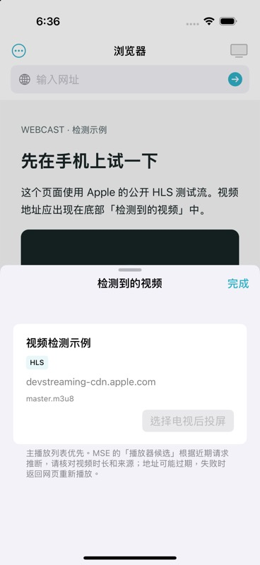
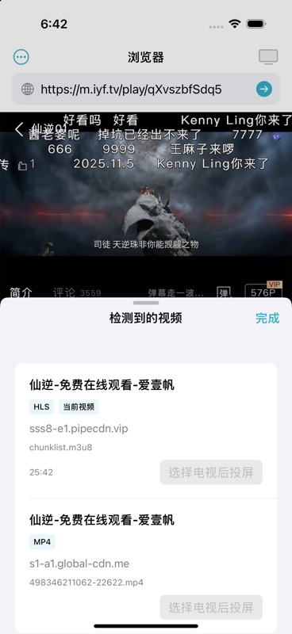

<p align="center">
  
</p>

<h1 align="center">Webcast</h1>

<p align="center">
  <strong>Open a web video on your iPhone, cast it to Chromecast, and control it from your phone.</strong>
</p>

<p align="center">
  <a href="https://github.com/ycl-2004/Webcast/releases/tag/v0.1.2"></a>
  
  
  
  
  
</p>

<p align="center">
  <a href="https://github.com/ycl-2004/Webcast/releases/tag/v0.1.2"><strong>Download prerelease</strong></a> ·
  <a href="#quick-start">Quick start</a> ·
  <a href="#features">Features</a> ·
  <a href="#privacy">Privacy</a> ·
  <a href="#build-from-source">Build from source</a> ·
  <a href="https://github.com/ycl-2004/Webcast/issues">Feedback</a> ·
  <a href="README.zh-TW.md">繁體中文</a>
</p>

Webcast is a native iOS browser and Chromecast remote for watching web videos on a larger screen. Open a website, play a video, and choose a detected stream to send to the TV. The TV fetches the stream directly; the phone handles browsing and playback controls.

> **Current distribution:** [v0.1.2 (4) prerelease](https://github.com/ycl-2004/Webcast/releases/tag/v0.1.2) provides an **unsigned iPhone IPA** that requires your own signing, plus an **ad-hoc signed simulator app** for Xcode on a Mac. There is no App Store or TestFlight release. A separately signed development Release passed core iPhone 15 → Chromecast tests; full browser UI, lock-screen behavior and Wi-Fi recovery remain pending. [Release notes](docs/releases/0.1.2.md) · [Acceptance checklist](docs/ACCEPTANCE.md).

## Quick start

For an iPhone, [build and install Webcast](#build-from-source) using your own Apple signing account. The downloadable IPA requires signing before installation. To try the app on a Mac, use the [simulator package and installation commands](docs/releases/0.1.2.md#downloads-and-installation). For an installed phone copy:

1. Connect your iPhone and Chromecast or Google Cast-enabled TV to the same Wi-Fi. Allow Webcast's **Local Network** permission.
2. Open the **`浏览器`** tab, enter a website, and start playing a video. The default home page is 爱壹帆; you can change it in **`设置`**.
3. Tap **`视频`** at the bottom. Prefer **`当前视频`**, or compare the title, duration, and source before selecting a candidate.
4. Tap **`投到电视`** and choose your TV if it is not connected yet.
5. Open **`投屏遥控`** for playback, seeking, volume, mute, and stopping.

If a stream fails, replay the video in the browser and select a fresh candidate. A video working on the phone does not guarantee that the TV can fetch it.

### System requirements

- iOS 16.0 or later; the current signed build was installed on an iPhone 15.
- Chromecast or a Google Cast-enabled receiver, connected to the same Wi-Fi.
- Local Network permission for device discovery and casting.
- Internet access for web pages and remote video sources.
- The app includes English, Simplified Chinese, and Traditional Chinese localization; manual language acceptance remains pending. An iPad target is configured, but physical iPad acceptance has not been recorded.

## Why Webcast

- **Browse where the video lives.** Use a native web view instead of copying stream URLs into a separate player.
- **Choose what reaches the TV.** Inspect detected candidates and their source before casting.
- **Keep the phone useful.** Browsing, video selection, and the remote share one app.

## Features

**Browser**

- URL entry and Google or Bing search, back/forward navigation, refresh, and a configurable home page.
- Desktop-site requests, new-window blocking, and startup choices.
- Local website data with a setting to clear it and sign out of websites.

**Video detection**

- Detect native media and media requests in the page and its frames.
- Identify HLS and MP4 candidates; display current-video status, source, duration, and live information when available.
- Preserve signed URL parameters, remove duplicate candidates, and disable candidates identified as DRM-protected.
- Label inferred MSE candidates separately; **`可能是正片`** is an estimate, so check the source and duration.
- Put current media first, then prefer master playlists. Unknown duration is kept distinct from live playback.
- The native detection bridge runs in an isolated WebKit world. Page-provided observations have typed, bounded fields and message budgets; detected media still requires explicit user selection.

**Chromecast remote**

- Discover receivers and select a TV; once a TV has been used, **`投到 <TV>`** connects and casts in one tap whenever it is online.
- The phone's volume buttons control TV volume while the app is open; discovery stays on in the foreground so the Cast SDK can resume a session after unlocking or reopening the app (not yet verified on a TV).
- The Cast session suspends in the background and clears system media controls. Sustained lock-screen control is not supported; return to the app to resume. The TV fetches its stream independently, but actual playback continuity and reconnection still require receiver acceptance.
- Play/pause, seek, jump 15 seconds, change volume, mute, stop, and disconnect.
- Show connection and playback status, including loading and interrupted sessions. These controls are implemented; complete physical-device acceptance is still pending.

## How it works

`Website → detected media URL → selected Chromecast receiver → direct stream playback`

Webcast sends the chosen URL and media metadata to Google's Default Media Receiver. It does not mirror the phone's screen or proxy the video through the phone.

**`停止并断开`** asks for confirmation, then requests that the TV stop and disconnects the phone. A disconnect that keeps the TV playing is not offered: with only one sender connected, the Cast SDK stops playback even when its stop flag is false. [Google Cast API behavior](https://developers.google.com/cast/docs/reference/ios/interface_g_c_k_session_manager).

## Screenshots

<table>
  <tr>
    <td align="center"><strong>Apple HLS detection demo</strong><br></td>
    <td align="center"><strong>Web video candidates</strong><br></td>
  </tr>
</table>

These checked-in captures came from an earlier simulator build on 2026-10-07. They show real WebKit video detection; some browser controls and copy have since changed. They are not evidence of TV playback. Casting was disabled for these validation captures. [Capture context](docs/FEASIBILITY.md).

## Privacy

- Webcast has no app account or project-operated backend. Settings, the last visited URL, and the last selected tab are stored locally.
- WebKit stores website cookies, cache, and other website data on the device. **`设置 → 清除网站数据`** clears that data and the saved last URL; websites then require login again.
- Opening pages and searching contacts the chosen website or search engine. Casting sends the selected media URL, title, and source host to the receiver, which fetches the media from its origin.
- **Settings → Cast diagnostics** keeps the latest 20 failures in memory for the current process: stage, numeric code, timestamp, build, receiver model and source hostname. It excludes full media URLs, cookies and page content, is never uploaded, and can be cleared manually. Ending the app process clears it.
- Google Cast SDK analytics logging is disabled in the app configuration. Release builds also disable detailed SDK debug logging.
- The app bundles its own privacy manifest for local UserDefaults preferences; Google Cast keeps its own SDK manifest.
- Websites, search providers, media hosts, and Google Cast components have their own network and data behavior. Webcast is not an offline app and does not make their traffic private.

## Current release

**[v0.1.2 — build 4](https://github.com/ycl-2004/Webcast/releases/tag/v0.1.2)** is the first GitHub prerelease, packaged on 2026-10-28. Version metadata comes from [`project.yml`](project.yml). See the [release notes](docs/releases/0.1.2.md) for changes, installation, checksums and package reproduction.

| Artifact | Use |
| --- | --- |
| [Webcast-0.1.2-iOS-unsigned.ipa](https://github.com/ycl-2004/Webcast/releases/download/v0.1.2/Webcast-0.1.2-iOS-unsigned.ipa) | arm64, iOS 16+; unsigned, requires your own signing |
| [Webcast-0.1.2-Simulator.zip](https://github.com/ycl-2004/Webcast/releases/download/v0.1.2/Webcast-0.1.2-Simulator.zip) | Xcode iOS Simulator app; arm64 + x86_64, ad-hoc signed |
| [Webcast-0.1.2-ThirdPartyNotices.zip](https://github.com/ycl-2004/Webcast/releases/download/v0.1.2/Webcast-0.1.2-ThirdPartyNotices.zip) | Notices from the pinned Google Cast SDK archive |
| [release-manifest.json](https://github.com/ycl-2004/Webcast/releases/download/v0.1.2/release-manifest.json) | Version, toolchain, architectures, source hashes and bundle checks |
| [SHA256SUMS](https://github.com/ycl-2004/Webcast/releases/download/v0.1.2/SHA256SUMS) | SHA-256 verification for all four assets above |

Fresh simulator and arm64 iPhone Release builds passed bundle validation. The app extracted from the simulator ZIP installed and launched on iOS 18.6 / Apple Silicon. [GitHub CI](https://github.com/ycl-2004/Webcast/actions/runs/40733499670) passed tests and Release checks for the unchanged app source.

Prior hardware evidence: a separately signed **0.1.2 (4)** passed core HLS playback, pause, seek, resume, mute, stop and disconnect on a physical iPhone 15 / iOS 26.5 → Chromecast. [Phone test](artifacts/iphone-receiver-2026-10-26.json) · [Installation receipt](artifacts/iphone-2026-10-26.json). That personal development profile expires on 2026-11-02 and is excluded from the public packages.

Full browser-to-TV UI, picture/sound confirmation, lock-screen/Wi-Fi recovery, long playback, minimum-iOS and physical-iPad acceptance remain pending. See the [acceptance checklist](docs/ACCEPTANCE.md) and [hardening record](artifacts/hardening-2026-10-26.md). Earlier engineering evidence is linked from [validation](artifacts/validation.md).

## FAQ

<details>
<summary>Why does the video play on my phone but fail on the TV?</summary>

The receiver fetches the URL independently. A website may require browser cookies, request headers, a current signed URL, or DRM authorization that the receiver does not have. Replay the video and try a fresh candidate. Webcast currently has no relay or proxy for these cases.

</details>

<details>
<summary>Why is my TV missing?</summary>

Confirm that it supports Google Cast, is powered on, and shares the phone's Wi-Fi. In iOS Settings, allow Webcast to access the local network, then reopen the device picker. AirPlay-only and DLNA-only receivers are not supported.

</details>

<details>
<summary>Why does a Personal Team installation expire?</summary>

Personal Team provisioning profiles expire after seven days. Rebuild and reinstall with your signing account when needed. Release is the build configuration, not an App Store distribution certificate. [Apple's Personal Team explanation](https://developer.apple.com/help/account/basics/about-your-developer-account/).

</details>

Manual receiver QA is separate from normal offline tests. Run `python3 scripts/run_receiver_acceptance.py --help` for the explicit receiver/destination options. It requires `--allow-control`, uses public HLS at low volume, stops playback and restores volume afterward. It does not update Apple signing resources. See [the decision](docs/decisions/003-isolated-detection-and-receiver-qa.md).

## Build from source

<details>
<summary>Requirements, local signing, build, and validation commands</summary>

Use a Mac with Xcode and the iOS SDK, plus XcodeGen on your `PATH`. Local validation uses Xcode **27.1**. CI explicitly selects Xcode **26.3** and an iOS **18.6** simulator; the [build-source CI run](https://github.com/ycl-2004/Webcast/actions/runs/40733499670) passed. Google Cast uses the official **4.8.6** dynamic archive, pinned by URL and checksum in [`Packages/GoogleCast/Package.swift`](Packages/GoogleCast/Package.swift). This binary-only SPM manifest avoids duplicate classes observed with the upstream wrapper ([decision](docs/decisions/002-media-origin-and-official-sdk.md)); the first build needs network access for dependencies.

```sh
git clone https://github.com/ycl-2004/Webcast.git
cd Webcast
make generate
open Webcast.xcodeproj
```

For device installation, sign in under **Xcode Settings → Apple Accounts**, select your team, and leave automatic signing enabled. Pair and trust the phone, and enable Developer Mode.

Create `Config/Signing.local.xcconfig` with your Xcode Team ID:

```text
DEVELOPMENT_TEAM = <YOUR_TEAM_ID>
```

Create `.device.mk` with your phone's UDID:

```make
DEVICE_UDID := <YOUR_DEVICE_UDID>
```

Both files are ignored by Git. Replace the placeholders with your own values. Regenerating the Xcode project preserves these local settings.

```sh
make build           # Unsigned simulator Release
make check-release   # Build Release and verify packaged resources/privacy/debug isolation (Python 3)
make release         # Unsigned physical-device Release; does not install
python3 scripts/package_release.py --output artifacts/Release/v0.1.2  # Package both Release builds; requires fresh output filenames
make device-build    # Signed physical-device Release; does not install
make device-install  # Build and install; does not launch the app
make device          # Build, install, and launch the app
```

List installed simulators, then run tests using the chosen UUID:

```sh
xcrun simctl list devices available
make test SIMULATOR_ID='<SIMULATOR_UUID>'

# Alternatively, choose a device name and its installed iOS version:
make test SIMULATOR='iPhone 16 Pro' SIMULATOR_OS=18.6
```

`SIMULATOR_ID` takes priority over name and OS. Without a UUID, the defaults are `iPhone 17` and `latest`; when multiple runtimes are installed, specify the version matching the device name.

To open the bundled HLS demo, first boot a simulator and use its UUID:

```sh
make demo SIMULATOR_ID='<BOOTED_SIMULATOR_UUID>'
```

The default build, Run, Profile, and Archive configurations are Release; tests explicitly use Debug. Tests and the demo use `WEBCAST_OFFLINE_VALIDATION=1` to skip Cast SDK initialization and TV commands. This disables casting, not web-page networking. Demo and inspection tools are compiled out of Release.

The existing records verify simulator builds/tests and signed device build/install on the development machine. Setup with another Apple account or a clean Mac has not been tested.

</details>

## Project layout

| Path | Responsibility |
| --- | --- |
| `project.yml`, `Makefile`, `Package.resolved` | Xcode generation, builds, and pinned dependencies |
| `Webcast/Browser/`, `Webcast/Views/` | Browser state and native interface |
| `Webcast/Sniffer/`, `Webcast/Models/` | Media detection, candidate ranking, and URL rules |
| `Webcast/Cast/` | Device discovery, sessions, media loading, and remote controls |
| `Webcast/Assets.xcassets/`, `artwork/` | App icon, preserved original, and generation brief |
| `Tests/Swift/` | Unit and real WebKit integration tests |
| `scripts/` | Release bundle verification, packaging and opt-in receiver QA |
| `docs/`, `artifacts/` | Feasibility, acceptance, screenshots, and validation evidence |

## Versioning and releases

Update `CFBundleShortVersionString` and `CFBundleVersion` in `project.yml`, then run `make generate` to refresh `Webcast/Info.plist` and the generated project. Keep documentation aligned with the actual build.

Tags use `v<version>`; the first is `v0.1.2`. GitHub releases attach the versioned unsigned IPA, simulator ZIP, SDK notices, `release-manifest.json` and `SHA256SUMS`. The manifest identifies the build-source commit and product-file hashes; release documentation can be committed afterward without changing the app. See [package reproduction](docs/releases/0.1.2.md#reproduce-the-packages).

Local signing files, device identifiers, generated projects and app bundles stay outside Git. Public packages contain no personal provisioning profile. App Store/TestFlight distribution requires a separate signing and release setup.

## Contributing

[Report an issue](https://github.com/ycl-2004/Webcast/issues) with the iOS version, receiver model, website, steps, and expected result. Remove cookies and temporary signed media URLs from reports. See [License](#license) before reusing or distributing the source.

## Known limitations

- Direct receiver playback only: no screen mirroring, AirPlay, DLNA, local proxy, or background audio keep-alive.
- Some sites and special players cannot be detected or played; supported candidates may still fail receiver authentication or format checks.
- DRM detection is best-effort. An unmarked candidate is not proof that a stream is DRM-free.
- Subtitles, queues, ad filtering, browsing history, and bookmarks are not implemented.
- Individual remote actions, specified 爱壹帆 episodes, lock-screen recovery, Wi-Fi recovery, and physical iPad use are not fully verified.
- Personal Team installations need periodic re-signing; there is no automatic updater, App Store or TestFlight release. The public IPA requires your own signing.

## License

No project license has been selected, and this repository contains no `LICENSE` file. Public source availability does not grant permission to copy, modify, redistribute, rebrand, or sell the project. Dependencies retain their own licenses.
